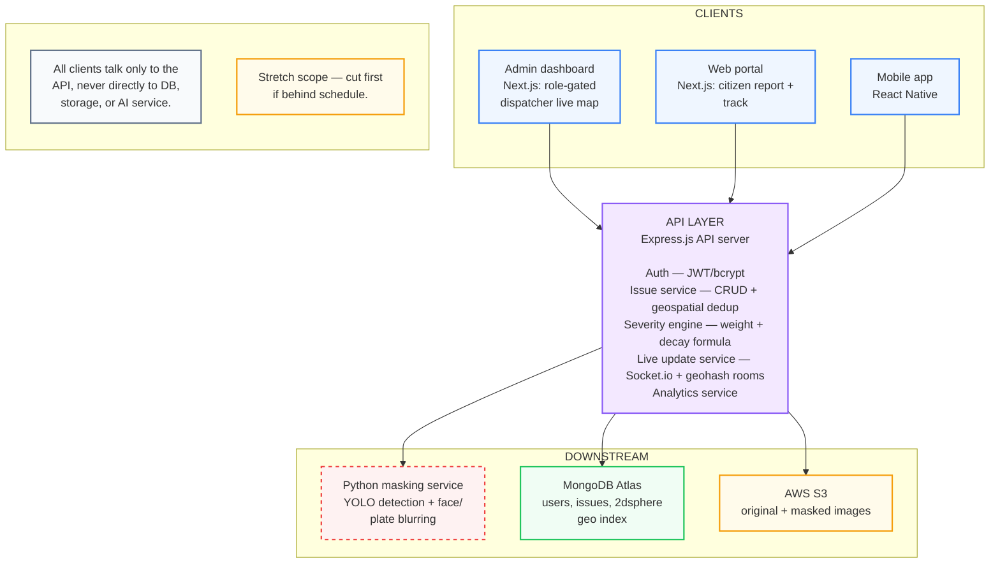

# UrbanOps

Real-time city infrastructure command center. Extends **UrbanLens** (prior semester's citizen-facing mobile reporting app) with a full MERN backend, geospatial deduplication, live dispatch dashboard, and role-gated web clients.

## Problem

UrbanLens lets citizens report issues (potholes, leaks, hazards) via photo + GPS. At scale, the same issue gets reported dozens of times, flooding the city's system with duplicate tickets and no way to prioritize.

## Solution

UrbanOps sits between citizen reports and city dispatchers:

1. **Dedup** — new reports are checked against existing open issues within 100m using the same category. Duplicates increment a counter instead of creating new tickets.
2. **Severity scoring** — each issue gets a score based on category weight, duplicate count, and time decay, so stale or low-impact issues naturally rank lower.
3. **Live dashboard** — dispatchers see new/updated issues instantly via WebSocket, segmented by geohash room (no GeoJSON ward-boundary dependency).
4. **Kanban workflow** — issues move Open → Dispatched → Resolved. No routing/VRP solver in v1 (explicitly scoped out — see PRD).

## Architecture



## Tech Stack

- **Frontend:** React Native (mobile), Next.js (web portal + admin dashboard)
- **Backend:** Node.js, Express.js
- **Database:** MongoDB Atlas (2dsphere geospatial index)
- **Real-time:** Socket.io (geohash-keyed rooms)
- **Storage:** local disk behind a storage module (AWS S3 planned)
- **Photo masking:** Python (FastAPI, YOLO, OpenCV), a separate service in `masking/`

## Core Modules

| Module | Responsibility |
|---|---|
| Auth service | JWT + bcrypt, role-based access (citizen / dispatcher / admin / superadmin), state jurisdiction, invites, password reset |
| Issue service | CRUD, `$geoNear` + category dedup |
| Severity engine | `baseWeight + (duplicateCount × multiplier) − (hoursSinceLastReport × decayRate)` |
| Live update service | Socket.io, geohash-prefix rooms |
| Analytics service | Daily opened/resolved trends, time to resolve, category and state breakdowns |
| Photo storage | Upload validation and storage behind one module (local disk now, S3-ready) |
| Notifications | Emails reporters when their issue is dispatched or resolved |
| Photo masking | Separate Python service (`masking/`): YOLO finds faces and number plates, which are blurred in a copy of each photo |

## Running Locally

Requires Node 20+ and MongoDB (local `mongodb://127.0.0.1:27017` or an Atlas URI).

```bash
# 1. Backend (repo root)
npm install
cp .env.example .env          # set JWT_SECRET; change PORT if 5000 is taken
npm run seed                  # creates the superadmin, admin and dispatcher accounts below
npm run dev                   # API + Socket.io on http://localhost:5000

# 2. Frontend (new terminal)
cd frontend
npm install
cp .env.example .env.local    # NEXT_PUBLIC_API_URL must match the backend port
npm run dev                   # http://localhost:3000
```

Sign in at `http://localhost:3000/login` (accounts created by `npm run seed`):

| Account | Password | Role | Sees |
|---|---|---|---|
| `superadmin@urbanops.local` | `super12345` | Superadmin | Every state; invites state admins; analytics across states |
| `admin@urbanops.local` | `admin12345` | Admin (Karnataka) | Dashboard, Kanban, live map, analytics, manages that state's dispatchers |
| `dispatcher@urbanops.local` | `dispatch12345` | Dispatcher (Karnataka) | Dashboard, Kanban board, live map |
| Register a new account | — | Citizen | Report an issue (with photos), track "My reports" |

These passwords are development defaults; set the `SEED_*` variables before seeding anything that is not your own machine.

### With Docker

```bash
docker compose up --build                                                    # web :3000, api :5000, MongoDB, photo masking
docker compose run --rm -e NODE_ENV=development api node scripts/seed.js     # first run: demo accounts
```

`docker-compose.yml` is for local demos. Before running it on a server, put a real `JWT_SECRET` in a `.env` file next to it; the fallback value in the file is public.

### Tests

| Command | Where | What it covers |
|---|---|---|
| `npm test` | repo root | API: auth, roles and jurisdiction, dedup, severity, live updates, photos, photo masking (against a stand-in service), notifications, analytics, password reset. Uses a throwaway `urbanops_test` database. |
| `npm run lint`, `npm run build` | `frontend/` | ESLint and a production build (includes type-checking). |
| `docker run --rm urbanops-masker python smoke_test.py` | anywhere | The masking service with its real models: faces in a sample photo are found and are gone afterwards. |
| `npm run test:e2e` | `frontend/` | Browser tests (Playwright) of the main journey: report with a photo → second citizen joins it → dispatch → resolve with a note → citizen sees the outcome → analytics → heatmap → password reset. Starts its own API (port 5055, `urbanops_e2e` database) and web app (port 3100). First time: `npx playwright install chromium`. Stop `npm run dev` in `frontend/` first, as Next.js allows one dev server per folder. |

### Photo masking

Faces and vehicle number plates in report photos are blurred, so bystanders are not identifiable. It is off unless the API has `MASKING_URL`; `docker compose up` switches it on for you.

To use it with `npm run dev`, start the service on its own and add `MASKING_URL=http://127.0.0.1:8000` to `.env`:

```bash
docker build -t urbanops-masker ./masking      # first build downloads PyTorch; takes several minutes
docker run --rm -p 8000:8000 urbanops-masker
```

How it behaves:

- Each uploaded photo is stored twice: the original, and a copy with the detected regions blurred. If nothing is found, no second file is made.
- Citizens only ever receive the blurred copy. Staff see the blurred copy as the thumbnail and can open the original.
- If the service is down or slow, the report is still saved. That photo is kept from citizens until it has a blurred copy; `npm run mask:backfill` makes the missing ones (also for photos uploaded before masking was switched on).
- Detection is a model, not a guarantee: small, distant or turned-away faces and plates can be missed. `MASK_IMGSZ`, `FACE_CONF` and `PLATE_CONF` on the service trade speed for recall.
- Originals stay on disk at their unguessable `/uploads/` address, which is not behind a login.

The detection models are third-party weights under GPL-3.0 (face) and AGPL-3.0 (plates, and the `ultralytics` library); their sources and checksums are in `masking/Dockerfile`. Check those terms before using this outside coursework.

All of these run on every push and pull request (`.github/workflows/ci.yml`). `npm run demo` walks through the dedup/severity flow against a running server.

## Features

**Citizens**
- Report an issue with GPS or a map pin and up to 3 photos (JPEG, PNG or WebP, 5 MB each).
- Before submitting, see open issues within 300 m and add yourself with "I see this too" instead of filing a duplicate.
- Follow each report live in "My reports"; get an email when it is dispatched and when it is resolved, including what was done.
- Reset a forgotten password by email. Installable on a phone's home screen (web app manifest).

**Dispatchers and admins**
- Live dashboard, Kanban board (drag and drop) and ops map with clustered markers or a severity-weighted heatmap.
- Resolving or closing an issue asks for a note, which the reporters see.
- Admins get an analytics page: issues opened and resolved per day, time to resolve, most reported types, and a per-state table for the superadmin.

**Roles** (enforced by the API; the UI only hides what you cannot do)

| Role | Scope | Created by |
|---|---|---|
| Citizen | Own reports | Self-registration |
| Dispatcher | One state: dispatch, assign, undo a dispatch, resolve | Their state admin (temporary password, changed at first sign-in) |
| Admin | One state: everything a dispatcher can do, plus close without dispatch, reopen, manage dispatchers, analytics | Invite code from the superadmin |
| Superadmin | All states | `npm run seed` on the server only |

### API overview

All paths are under `/api/v1`. Send `Authorization: Bearer <token>`.

| Method | Path | Access |
|---|---|---|
| POST | `/auth/register`, `/auth/login` | Public |
| POST | `/auth/register-admin` | Public, needs an invite code |
| POST | `/auth/forgot-password`, `/auth/reset-password` | Public; reset links work once and expire in 30 minutes |
| GET | `/auth/me` | Signed in |
| POST | `/auth/change-password` | Signed in; invalidates every older token |
| POST | `/issues` | Signed in: submit a report. JSON, or `multipart/form-data` with up to 3 `photos` |
| GET | `/issues/nearby?lat=&lng=&radius=` | Signed in: open issues around a point (public view) |
| POST | `/issues/:id/confirm` | Signed in: "I see this too" |
| GET | `/issues/mine`, `/issues/:id` | Signed in (citizens: only issues they reported, public view) |
| GET | `/issues`, `/issues/stats` | Staff, limited to their state |
| PATCH | `/issues/:id` | Staff: `status`, `assignedTo`, and `note` when resolving |
| GET | `/issues/analytics?days=&tz=&region=` | Admin, superadmin |
| GET | `/users/dispatchers` | Staff: who can be assigned |
| GET, POST, PATCH | `/users`, `/users/staff`, `/users/:id/role`, `/users/:id/reset-password` | Admin (own state), superadmin |
| GET, POST, DELETE | `/invites` | Superadmin |

Report photos are served at `/uploads/<random name>`. Each is `{ original, masked }`; see Photo masking above for who receives which. They are stored on the API server's disk (`UPLOAD_DIR`); `services/storage.js` is the only file that knows that, so moving to S3 means replacing it.

Live updates: connect Socket.io with `auth: { token }`. Staff receive `issue:created` / `issue:updated` for their state, or emit `subscribe` with a `bbox` to narrow to the geohash cells of a map area. Citizens receive updates for issues they reported.

## Explicit Scope Cuts

- **No multi-stop routing / VRP solver.** NP-hard, out of scope for a 12–15 week semester project. Kanban board replaces it. Production version would integrate OSRM/Google Directions API.
- **No ward-boundary WebSocket rooms.** Geohash prefix used instead to avoid a GeoJSON boundary-data dependency.
- **Mobile app (React Native) is not in this repository.** The web portal is installable on a phone instead.

## Team

1RUA24SCS0068 Nishit Patel · 1RUA24SCS0072 Pragun Lal Shrestha · 1RUA24SCS0077 Pranav Adhikari · 1RUA24SCS0118 Unique Bhakta Shrestha . 1RUA24SCS0099 Sameera Simha Jayasimha
